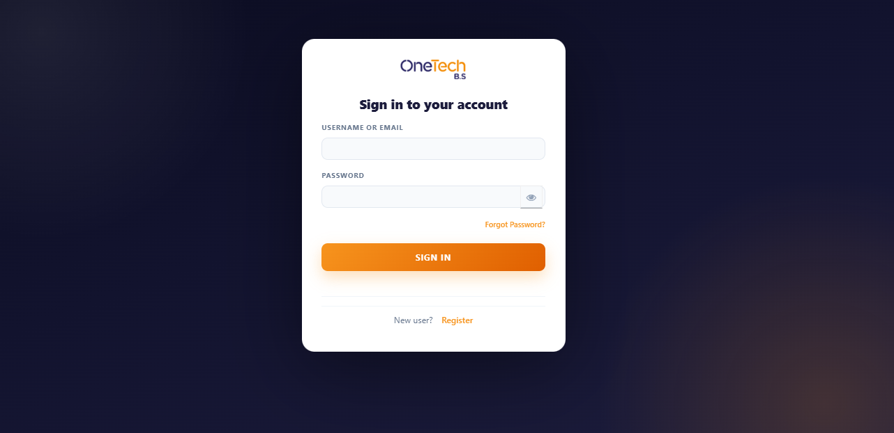
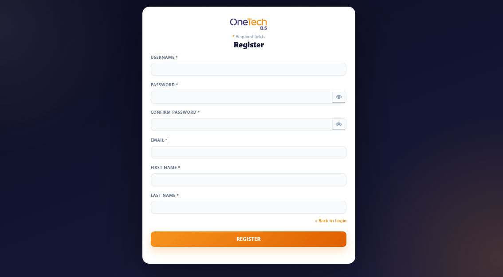
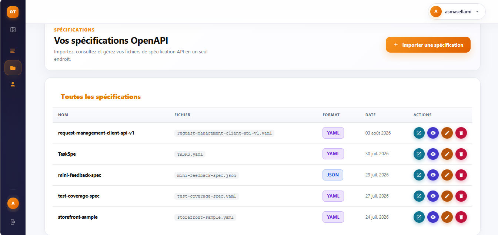
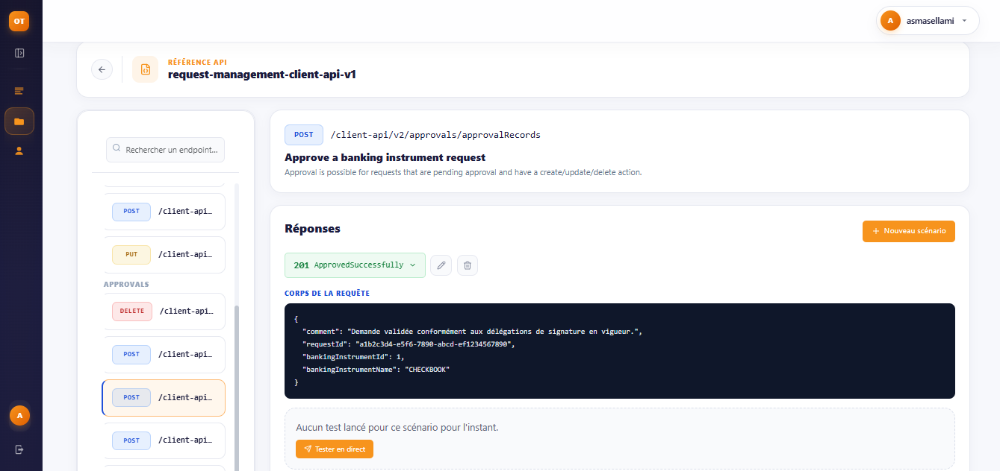
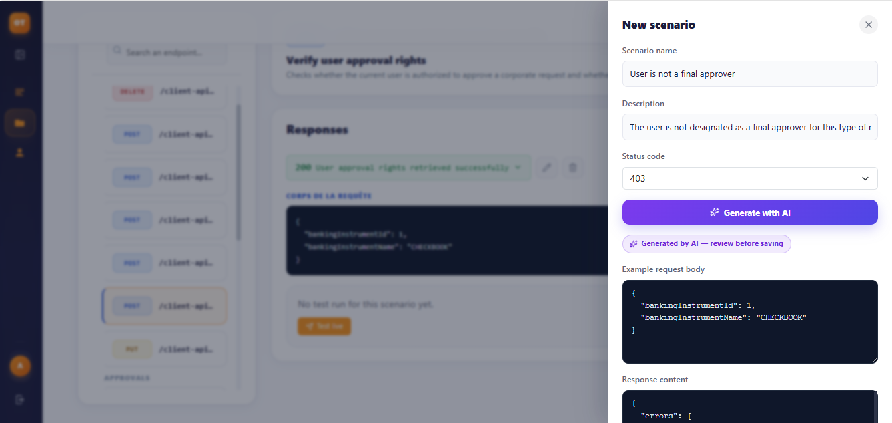
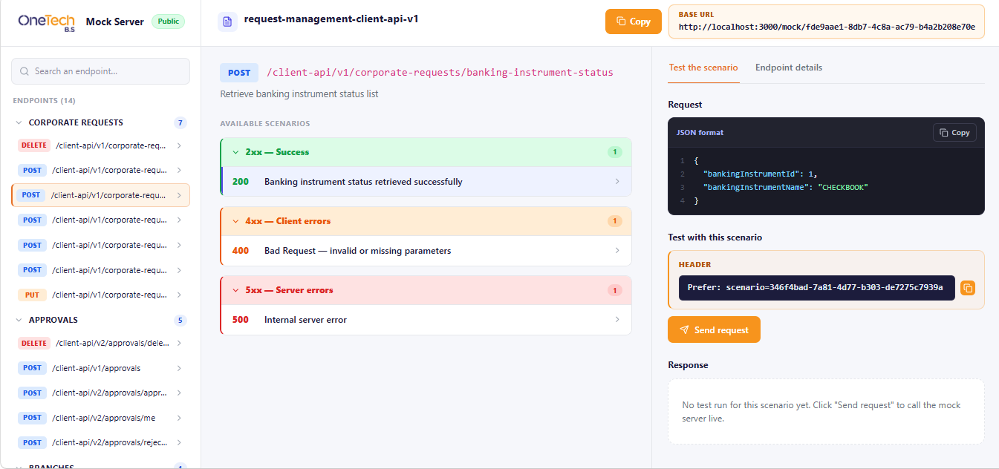

# OneTech Mock Platform

**An automatic mock API generator based on OpenAPI.**

Import an OpenAPI specification (YAML or JSON) and the platform instantly gives you a working mock server: realistic data, several named scenarios per HTTP status code, automatically generated error cases, AI assistance, and a public page you can share with your team. Frontend developers can keep building and testing their screens while the real Backend is still being written.

> Engineering internship project, built at **OneTech Business Solutions (OTBS)** – ESPRIT School of Engineering, 2025–2026.

---

## Table of contents

- [Features](#features)
- [Screenshots](#screenshots)
- [Architecture](#architecture)
- [Tech stack](#tech-stack)
- [How it works](#how-it-works)
- [Getting started](#getting-started)
- [Keycloak setup](#keycloak-setup)
- [Environment variables](#environment-variables)
- [Using the mock server](#using-the-mock-server)
- [Project structure](#project-structure)
- [API overview](#api-overview)
- [Scripts](#scripts)
- [Security notes](#security-notes)
- [Troubleshooting](#troubleshooting)
- [Roadmap](#roadmap)

---

## Features

| Feature | Description |
|---|---|
| **OpenAPI import** | Upload a YAML or JSON specification. Endpoints, parameters, request bodies and responses are extracted and stored. |
| **Automatic scenarios** | One scenario is generated for every response code declared in the spec (200, 400, 403, 404, 500…). |
| **Realistic data** | Values come from `example`, `enum`, `format`, `minimum`/`maximum`, field-name rules, and AI suggestions for fields the rules cannot handle. |
| **Smart error cases** | 400/422 scenarios are built from the real schema constraints: a missing required field, a broken `pattern`, an invalid `enum`, a value out of bounds. 403 messages reuse the access-control metadata of the spec. |
| **Several scenarios per status code** | For example three different 403 cases for the same endpoint, each with its own name, description and body. |
| **AI scenario assistant (Gemini)** | Describe a scenario in natural language and generate a coherent request example and response body. Always reviewed by the user before saving. |
| **Live mock server** | Any HTTP client (Postman, a frontend app) can call `/mock/<specId>/<path>` and receive the chosen scenario, including status code, headers and optional delay. |
| **Scenario selection** | Pick the response with the standard `Prefer` header: `Prefer: code=403` or `Prefer: scenario=<id>`. |
| **Public sharing page** | Every specification has a public page (no login) to browse endpoints, read scenarios and try them from the browser. |
| **Dashboard** | Number of specifications, endpoints and scenarios, scenarios by status family, endpoints by HTTP method, error-case coverage. |
| **Authentication with Keycloak** | Sign in, registration and password reset delegated to Keycloak; the API verifies RS256 JWTs. |
| **Per-user isolation** | Users only see and edit their own specifications and scenarios. |

---

## Screenshots

### Sign in and registration (Keycloak)

| Sign in | Register |
|---|---|
|  |  |

### Specifications

Import, view, edit and delete your OpenAPI files, and open the public mock server of each one.



### API reference and scenarios

Endpoints are grouped by tag. For each endpoint you can read its responses, add scenarios and run them live.



### Generate a scenario with AI

Write a name, a description and a status code, then let Gemini propose a request example and a response body. The result is clearly marked as AI-generated and must be reviewed before saving.



### Public mock server page

Accessible without authentication. Endpoints are listed on the left, scenarios are grouped by status family (2xx, 4xx, 5xx), and the right panel shows the request, the `Prefer` header to use, and the live response.



---

## Architecture

```
                      ┌──────────────────────┐
   Browser ─────────► │  React (Vite) :5173  │
                      └──────────┬───────────┘
                                 │ login redirect / JWT
                                 ▼
                      ┌──────────────────────┐
                      │  Keycloak :9099      │  realm: mock-platform
                      └──────────▲───────────┘
                                 │ JWKS (public keys) + admin API
 Postman / Frontend              │
 ───────────────┐      ┌────────┴─────────────┐        ┌────────────────────┐
  /mock/<id>/…  └────► │   NestJS API :3000   │ ─────► │  Prisma ORM        │
  (no auth)            │  business logic      │        └─────────┬──────────┘
                       └────────┬─────────────┘                  ▼
                                │                      ┌────────────────────┐
                                ▼                      │  PostgreSQL :5432  │
                       ┌──────────────────┐            └────────────────────┘
                       │  Gemini API (AI) │
                       └──────────────────┘
```

- **Presentation layer:** React single page application.
- **Authentication:** Keycloak issues JWT access tokens. The backend validates them with the realm public keys.
- **Business layer:** NestJS parses specifications, generates data and scenarios, and serves the mock responses.
- **Persistence layer:** Prisma ORM over PostgreSQL.
- **AI:** Google Gemini, used only when the rules cannot produce good values, and in the scenario assistant. The mock server itself never calls Gemini, so it answers fast and works offline.

There is **no extra port for the mock server**. The "public" server is the same NestJS application: the `/mock/*` and `/public/*` routes simply have no authentication guard, and each specification is identified by a UUID in the URL.

---

## Tech stack

**Frontend**
- React 19, React Router 7
- Vite 8
- Tailwind CSS 4, Bootstrap 5 / React-Bootstrap
- Chart.js with react-chartjs-2
- Lucide icons
- keycloak-js

**Backend**
- NestJS 11 (TypeScript)
- Prisma ORM 6 with PostgreSQL
- Passport (JWT strategy) + jwks-rsa
- `@apidevtools/swagger-parser` and `js-yaml` for OpenAPI parsing and validation
- class-validator / class-transformer
- Jest for tests

**Infrastructure and services**
- PostgreSQL
- Keycloak (identity and access management)
- Google Gemini API (AI)
- Brevo (transactional e-mail, used by the legacy OTP endpoints)

---

## How it works

1. **Import.** A user uploads an OpenAPI file. The backend validates and dereferences it (`$ref` resolved), extracts every endpoint and stores it.
2. **AI enrichment.** Fields without an example, enum, format or known name rule ("weak fields") are sent to Gemini in batches. The suggestions are stored in the `FieldSuggestion` table and reused, so each field is asked only once.
3. **Scenario generation.** One scenario per declared status code is created and saved, with its JSON body already generated. Success codes (200, 201, 202) are marked as the default scenario.
4. **Calling the mock.** A request to `/mock/<specId>/<path>` finds the matching endpoint, chooses the scenario (default, or `Prefer` header), waits for the optional delay, then returns the stored status code, headers and body.
5. **Manual edits are protected.** Scenarios keep `*IsAuto` flags: once you edit a request or response by hand, automatic regeneration no longer overwrites it.

---

## Getting started

### Prerequisites

- Node.js 20 or later and npm
- PostgreSQL 14 or later
- Keycloak 26 (see [Keycloak setup](#keycloak-setup))
- A Google Gemini API key (optional, only for the AI features)

### 1. Clone and install

```bash
git clone <your-repository-url>
cd OneTech_stage

cd backend && npm install
cd ../Mock-Platform-FrontEnd && npm install
```

### 2. Create the database

```bash
psql -U postgres -c "CREATE DATABASE mock_platform;"
```

### 3. Configure the environment

Copy the example files and fill them in (see [Environment variables](#environment-variables)):

```bash
cp backend/.env.example backend/.env
cp Mock-Platform-FrontEnd/.env.example Mock-Platform-FrontEnd/.env
```

### 4. Start Keycloak

```bash
docker run -d --name keycloak -p 9099:8080 \
  -e KC_BOOTSTRAP_ADMIN_USERNAME=admin \
  -e KC_BOOTSTRAP_ADMIN_PASSWORD=admin \
  quay.io/keycloak/keycloak:26.2 start-dev
```

Then configure the realm as described in [Keycloak setup](#keycloak-setup).

### 5. Run the backend

```bash
cd backend
npx prisma generate
npx prisma migrate deploy
npm run start:dev          # http://localhost:3000
```

### 6. Run the frontend

In a second terminal:

```bash
cd Mock-Platform-FrontEnd
npm run dev                # http://localhost:5173
```

Open <http://localhost:5173>, you will be redirected to Keycloak to sign in or register.

**Start order:** PostgreSQL → Keycloak → backend → frontend.

| Service | URL |
|---|---|
| Frontend | http://localhost:5173 |
| Backend API | http://localhost:3000 |
| Keycloak | http://localhost:9099 |
| Prisma Studio | `npm run prisma:studio` in `backend` |

---

## Keycloak setup

The application expects these values (they are currently hard-coded in `Mock-Platform-FrontEnd/src/keycloak.ts` and read from the backend `.env`):

| Item | Value |
|---|---|
| URL | `http://localhost:9099` |
| Realm | `mock-platform` |
| Frontend client | `mock-platform-frontend` |
| Backend admin client | `mock-platform-backend-admin` |

### Create the realm

1. Open <http://localhost:9099> and sign in to the admin console.
2. Create a realm named `mock-platform`.

### Frontend client (`mock-platform-frontend`)

- **Client authentication:** off (public client)
- **Standard flow:** on
- **Valid redirect URIs:** `http://localhost:5173/*`
- **Valid post logout redirect URIs:** `http://localhost:5173/*`
- **Web origins:** `http://localhost:5173`

### Backend admin client (`mock-platform-backend-admin`)

Used by the API to update a user's profile and password.

- **Client authentication:** on
- **Service accounts roles:** on
- In **Service account roles**, assign the `realm-management` roles `manage-users` and `view-users`
- Copy the client secret from the **Credentials** tab into `KEYCLOAK_ADMIN_CLIENT_SECRET`

### Realm settings

- **Login:** enable *User registration*, *Forgot password*, *Email as username* if you want users to sign in with their e-mail, and *Verify email* if you want to confirm addresses.
- **Themes:** select the login theme you want (the screenshots use a OneTech-branded login theme).
- **Email (SMTP):** required for "Forgot password" and e-mail verification. Example for Gmail:

  | Field | Value |
  |---|---|
  | Host | `smtp.gmail.com` |
  | Port | `465` with **Enable SSL** on and StartTLS off (or `587` with StartTLS on and SSL off) |
  | From | your Gmail address |
  | Authentication | enabled, username = your Gmail address |
  | Password | a Google **app password** (16 characters, no spaces), not your normal password |

  Use **Test connection** to check it. If the log shows `535 Username and Password not accepted`, create a new app password in your Google account (2-step verification must be enabled).

> Tip: once the realm is configured, export it (*Realm settings → Action → Partial export*) and commit the JSON file so others can import it instead of configuring everything by hand.

### First user

Click **Register** on the Keycloak login page. The backend creates the matching local user automatically the first time a valid token is presented.

---

## Environment variables

### `backend/.env`

```env
# Database
DATABASE_URL="postgresql://postgres:<password>@localhost:5432/mock_platform"

# Local JWT (legacy endpoints)
JWT_SECRET=change-me
JWT_EXPIRES_IN="7d"

# Keycloak
KEYCLOAK_URL=http://localhost:9099
KEYCLOAK_REALM=mock-platform
KEYCLOAK_ADMIN_CLIENT_ID=mock-platform-backend-admin
KEYCLOAK_ADMIN_CLIENT_SECRET=<client-secret>

# Brevo (transactional e-mail, legacy OTP endpoints)
BREVO_API_KEY=<brevo-api-key>
BREVO_SENDER_EMAIL=you@example.com
BREVO_SENDER_NAME="Mock Platform"

# Gemini (AI features)
GEMINI_API_KEY=<gemini-api-key>
# GEMINI_MODEL=gemini-3.5-flash-lite

# Optional
# PORT=3000
```

### `Mock-Platform-FrontEnd/.env`

```env
# Base URL shown on the public page and used to call the mock server
VITE_MOCK_BASE_URL=http://localhost:3000
```

Never commit real `.env` files. They are already ignored by `.gitignore`.

---

## Using the mock server

Every specification gets a base URL, shown on its public page:

```
http://localhost:3000/mock/<specId>
```

Append the path of any endpoint from your OpenAPI file and use its HTTP method.

```bash
# Default scenario (the success case)
curl http://localhost:3000/mock/<specId>/client-api/v1/customers/details

# Force a status code
curl -H "Prefer: code=403" \
  http://localhost:3000/mock/<specId>/client-api/v1/customers/details

# Force one precise scenario
curl -H "Prefer: scenario=<scenarioId>" \
  http://localhost:3000/mock/<specId>/client-api/v1/customers/details

# POST with a body (the body is not validated by the mock)
curl -X POST -H "Content-Type: application/json" \
  -d '{"customerId":"1"}' \
  http://localhost:3000/mock/<specId>/client-api/v1/payments/pay
```

| `Prefer` header | Result |
|---|---|
| none | The default scenario (success) |
| `code=<status>` | A scenario with this status code (the default one if there are several) |
| `scenario=<id>` | Exactly this scenario |

The base URL alone (`/mock/<specId>`) is not an endpoint and returns a 404: always add the endpoint path.

Responses include the scenario status code and headers, the optional simulated delay, plus `X-Request-Id` and `X-Timestamp` headers.

---

## Project structure

```
OneTech_stage/
├── backend/                     NestJS API
│   ├── prisma/                  schema.prisma and migrations
│   └── src/
│       ├── auth/                Keycloak JWT strategy, guards, profile
│       ├── specification/       import, update, delete specifications
│       ├── parsing/             OpenAPI parsing and validation
│       ├── endpoint/            endpoint queries and spec warnings
│       ├── scenario/            scenario CRUD and AI generation
│       ├── mock-data/           data generator, constraint violations, Gemini client
│       ├── mock-proxy/          the /mock/:specId/* server
│       ├── public-mock/         the /public/specs/* routes
│       └── dashboard/           statistics
├── Mock-Platform-FrontEnd/      React application
│   └── src/
│       ├── pages/               specifications, API reference, public page, profile…
│       ├── components/          sidebar, navbar, scenario form, JSON viewer…
│       ├── context/             authentication context
│       └── services/            API client
└── docs/screenshots/            images used in this README
```

---

## API overview

Routes marked 🔒 require a Keycloak access token (`Authorization: Bearer <token>`).

| Method | Route | Description |
|---|---|---|
| 🔒 `POST` | `/specifications` | Import a specification (generates endpoints and scenarios) |
| 🔒 `GET` | `/specifications` | List your specifications |
| 🔒 `GET` `PATCH` `DELETE` | `/specifications/:id` | Read, update, delete |
| 🔒 `GET` | `/specifications/:id/endpoints` | Endpoints of a specification |
| 🔒 `POST` | `/scenarios` | Create a scenario |
| 🔒 `GET` | `/scenarios/endpoint/:endpointId` | Scenarios of an endpoint |
| 🔒 `POST` | `/scenarios/endpoint/:endpointId/generate-with-ai` | Generate a scenario with Gemini |
| 🔒 `PATCH` `DELETE` | `/scenarios/:id` | Update, delete a scenario |
| 🔒 `GET` | `/dashboard/stats` | Statistics |
| 🔒 `GET` `PUT` | `/auth/profile` | Read and update the profile |
| 🔒 `PATCH` | `/profile` | Update the profile (Keycloak admin API) |
| `GET` | `/public/specs/:specId` | Public specification info |
| `GET` | `/public/specs/:specId/endpoints` | Public endpoints and scenarios |
| `ALL` | `/mock/:specId/*` | The mock server |

---

## Scripts

### Backend (`backend/`)

| Command | Purpose |
|---|---|
| `npm run start:dev` | Start in watch mode |
| `npm run build` / `npm run start:prod` | Build and run in production mode |
| `npm run prisma:generate` | Generate the Prisma client |
| `npm run prisma:migrate` | Create and apply a migration (development) |
| `npm run prisma:studio` | Browse the database |
| `npm run fields:refresh` | Ask Gemini for new field suggestions and patch existing automatic scenarios |
| `npm run test` / `npm run test:e2e` | Unit and end-to-end tests |
| `npm run lint` | Lint and fix |

### Frontend (`Mock-Platform-FrontEnd/`)

| Command | Purpose |
|---|---|
| `npm run dev` | Start the Vite dev server |
| `npm run build` | Production build into `dist/` |
| `npm run preview` | Serve the production build |
| `npm run lint` | Lint |

---

## Security notes

- Passwords and sessions are handled by **Keycloak**, never by the application.
- The API validates **RS256** tokens against the realm public keys (JWKS) and checks the issuer.
- Every read or write of a specification or scenario checks that it belongs to the signed-in user.
- Input is validated with `class-validator` (`whitelist: true` removes unknown fields).
- The **mock server and the public page are intentionally unauthenticated**. The only protection is the unguessable UUID of the specification, so do not import specifications containing sensitive real data.
- CORS currently accepts any origin (`origin: true`). Restrict it to your frontend domain before deploying.
- Secrets live in `.env` files that must never be committed.

---

## Troubleshooting

| Problem | Cause and fix |
|---|---|
| `Cannot GET /mock/<specId>` | You called the base URL only. Add the endpoint path and use the right HTTP method. |
| "No endpoint found for …" | Wrong path or method, or the specification was not imported. |
| Keycloak `535 Username and Password not accepted` | The Gmail app password is invalid or revoked. Create a new one and paste it without spaces. |
| Forgot-password e-mail never arrives | Configure and test **Realm settings → Email** in Keycloak, and check the spam folder. |
| 401 on API calls | Expired or missing token, or `KEYCLOAK_URL` / realm mismatch between the backend and Keycloak. |
| Values like `string_value` in scenarios | The field had no example, enum, format or rule, and Gemini was unavailable. Set `GEMINI_API_KEY` and run `npm run fields:refresh`. |
| AI button returns "indisponible" | Missing or invalid `GEMINI_API_KEY`, or no internet access. Fill the scenario manually. |

---

## Roadmap

- Deploy the platform on a real hosting environment so teammates can reach the mock server and the public page from anywhere.
- Move the Keycloak URL, realm and client id of the frontend into environment variables.
- Restrict CORS and add rate limiting on the public routes.
- Add more automated tests (scenario generation, mock resolution).
- Export a Keycloak realm file for one-command setup.

---

## Author

**Asma Sellami**, TWIN, ESPRIT School of Engineering, at OneTech Business Solutions, 2025–2026.
